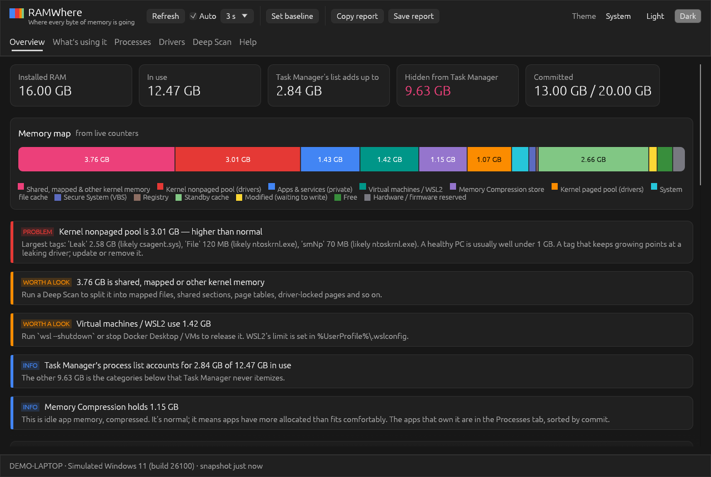
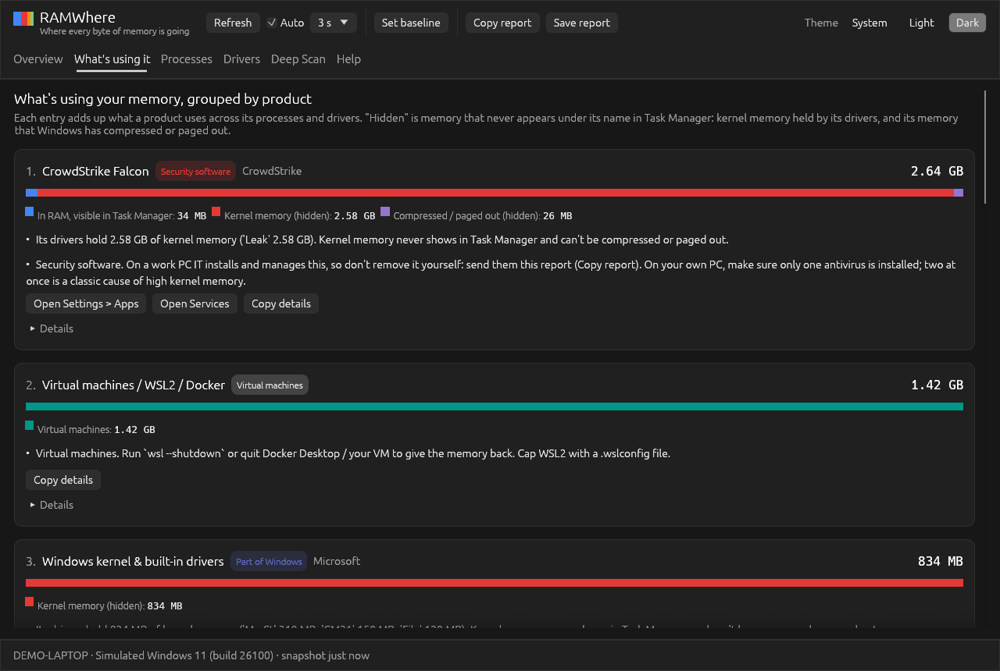

#  RAMWhere

**Task Manager says 9 GB is in use, but its process list adds up to 1.4 GB. Where's the rest?**

RAMWhere is a small Windows app that accounts for every byte of RAM, tells you which product is using it, and what you can do about it.

## Features

- **The whole picture**: a map of all your RAM, including the parts Task Manager never lists
- **Plain-English findings**: what each kind of memory is and whether it's a problem
- **Find the culprit**: memory grouped by product, like antivirus, VPNs, drivers or VMs, with advice for each
- **Spot leaks**: set a baseline and see what grows while you leave it running
- **Deep Scan**: a page-by-page breakdown when run as administrator
- **Share a report** to paste into a support ticket

## Download

Get `RAMWhere.exe` from the [latest release](../../releases/latest). It's a single file for 64-bit Windows 10 and 11, with nothing to install.

It isn't code-signed yet, so SmartScreen will warn you: click **More info → Run anyway**. Then click **Restart as administrator** for the full picture.

## Licence

Free and open source under the [GNU GPL v3 or later](LICENSE). Want to build it yourself? See [BUILDING.md](BUILDING.md).
