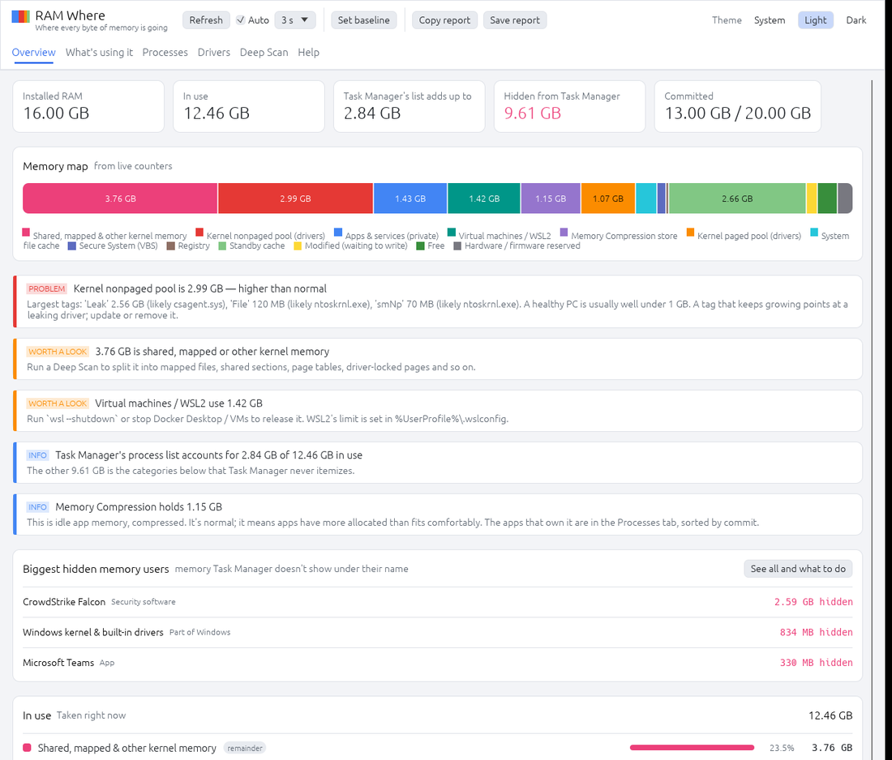
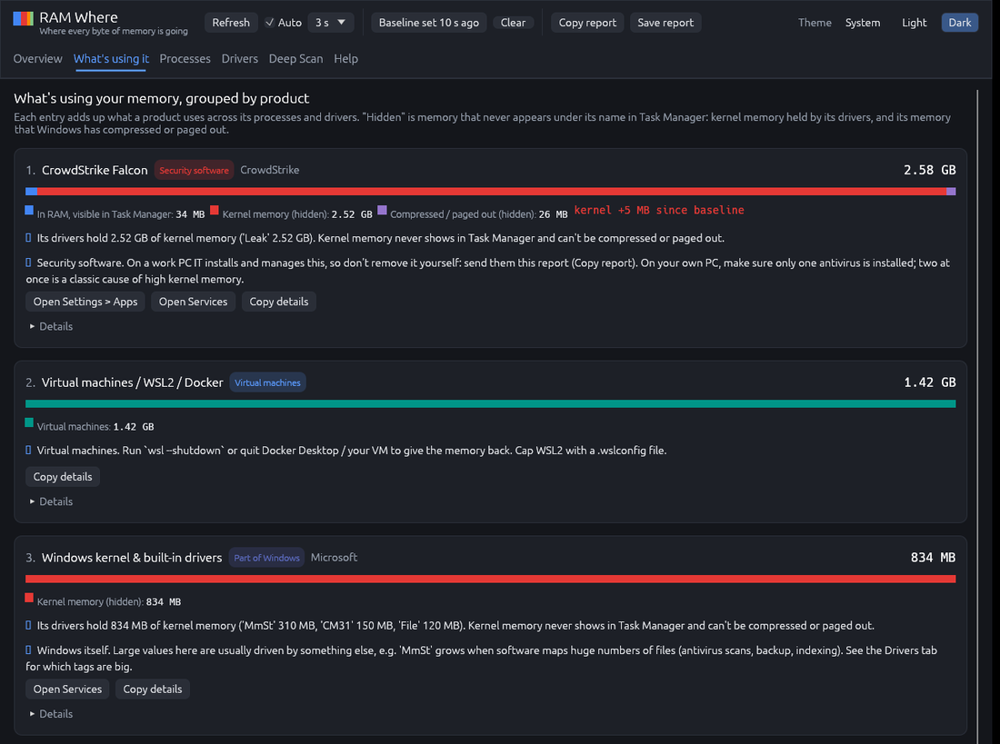

# RAM Where

**Task Manager says 9 GB is in use, but its process list adds up to 1.4 GB. Where's the rest?**

RAM Where is a small Windows app that accounts for every byte of RAM, including everything Task Manager
never itemizes, and tells you which product is responsible and what you can do about it.



## What it shows

- **Overview**: a memory map of all installed RAM, plain-English findings, and every category with an explanation:
  apps, kernel nonpaged/paged pool, Memory Compression, VBS (Secure System), WSL2/VMs, file cache, standby, modified,
  free and hardware-reserved memory.
- **What's using it**: memory grouped by product (drivers + processes), worst first, with the hidden part called out
  and advice for each type: security software, VPN clients, hardware drivers, manufacturer utilities, VMs, browsers.
- **Processes**: private, shared, total and committed memory, including the OS processes Task Manager hides.
- **Drivers**: kernel pool tags matched to the driver files that allocate them.
- **Deep Scan** (admin): walks the physical page database, the same source RAMMap uses, and splits memory into
  mapped files, shared sections, page tables, driver-locked pages, NTFS metadata, kernel stacks and more.
- **Set baseline**: every table gets a "Δ since baseline" column, so a leak stands out if you leave it running.
- **Copy / Save report**: text and JSON summaries to paste into a ticket.
- Light and dark mode, following the Windows setting.



## Download

Grab `ramwhere.exe` from the [latest release](../../releases/latest). It's a single exe for 64-bit Windows 10/11;
nothing to install. It isn't code-signed, so SmartScreen will warn you: **More info → Run anyway**.

Click **Restart as administrator** for the full picture (standby/modified lists and Deep Scan).

## Status

Early. Level 1 (the live counters) uses the same well-established kernel queries as Task Manager and Process
Explorer. Deep Scan relies on undocumented interfaces and may not work on every Windows build; if it misbehaves,
please open an issue with the output of **Copy report**. Product recognition uses a built-in list of common
drivers and programs (`src/culprits.rs`); additions are welcome.

## Command line

- `ramwhere.exe --report out.txt [--deep]`: write a text + JSON report without opening a window.
- `ramwhere.exe --glow`: use OpenGL instead of DirectX 12 (it falls back automatically if DirectX fails).

Put Microsoft's `pooltag.txt` next to the exe for richer pool tag descriptions. It's picked up automatically when
the Debugging Tools for Windows are installed.

## Build

```
cargo build --release --target x86_64-pc-windows-gnu   # cross-compile from Linux with mingw-w64
cargo build --release                                  # on Windows
cargo run                                              # on Linux/macOS: runs against simulated data
```

Written in Rust with [egui](https://github.com/emilk/egui). MIT licensed.
